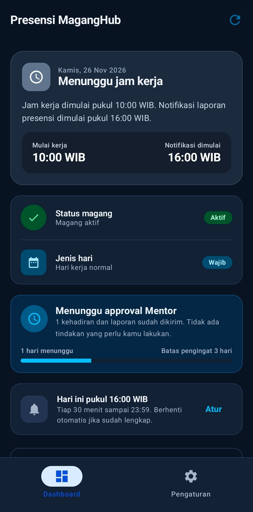
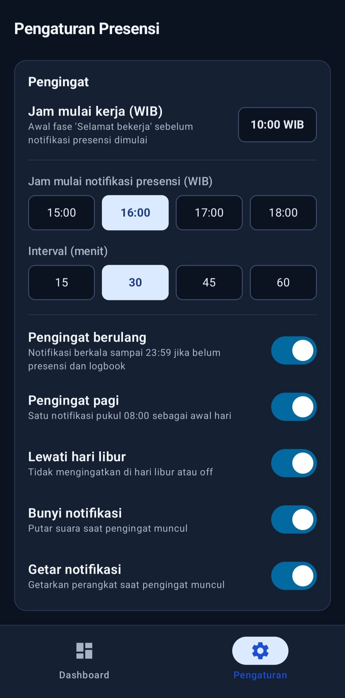
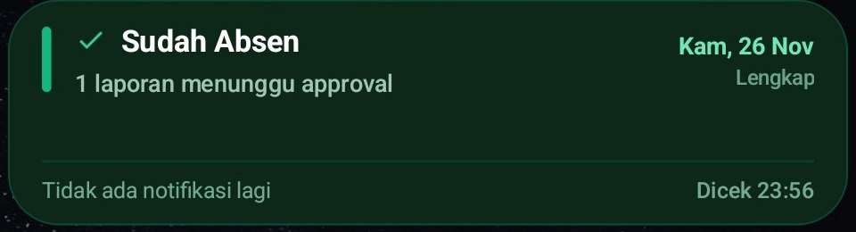
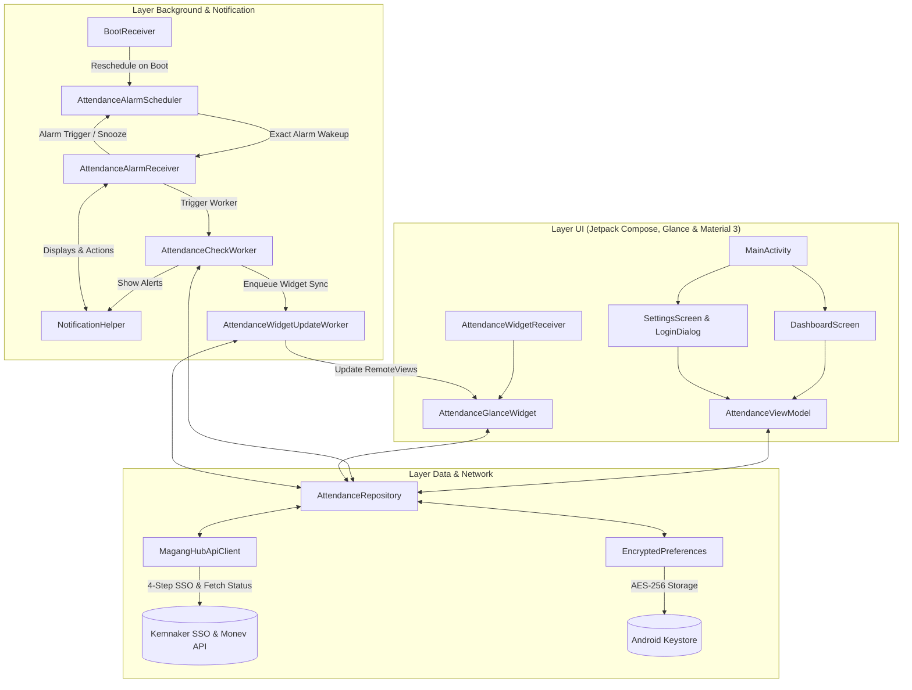

# MagangHub Logbook Companion

[](https://github.com/Churma16/maganghub-logbook-companion/actions/workflows/build-apk.yml)
[-brightgreen.svg)](https://developer.android.com)
[](https://kotlinlang.org)
[](https://developer.android.com/jetpack/compose)
[](https://developer.android.com/jetpack/androidx/releases/glance)
[](https://m3.material.io)
[](LICENSE)

Aplikasi Android pengingat presensi dan logbook harian peserta MagangHub Kemnaker (Monev). Cek status kehadiran otomatis, pantau langsung dari widget layar utama, dan nyalakan alarm tepat waktu kalau kamu belum absen sampai sore (16:00–23:59 WIB).

---

## Pratinjau Antarmuka

| Dashboard & Fase Kerja | Pengaturan Pengingat | Pengingat Approval Mentor |
|:---:|:---:|:---:|
|  |  |  |

<br/>

### Home Screen Widget (Jetpack Glance)

<p align="center">
  
</p>
<p align="center"><em>Widget layar utama (1x5) untuk cek presensi harian, status approval mentor, dan jadwal pengingat tanpa perlu buka aplikasi.</em></p>

---

## Daftar Isi
1. [Kenapa Aplikasi Ini Dibuat?](#kenapa-aplikasi-ini-dibuat)
2. [Pratinjau Antarmuka](#pratinjau-antarmuka)
3. [Fitur Utama](#fitur-utama)
4. [Arsitektur Aplikasi](#arsitektur-aplikasi)
5. [Download dan Cara Pasang APK](#download-dan-cara-pasang-apk)
6. [Pengaturan Agar Tidak Dimatikan OS (Anti-Kill)](#pengaturan-agar-tidak-dimatikan-os-anti-kill)
7. [Kompilasi dari Source Code](#kompilasi-dari-source-code)
8. [Keamanan dan Privasi](#keamanan-dan-privasi)
9. [Siklus Rilis dan Versioning](#siklus-rilis-dan-versioning)
10. [CI/CD Workflow](#cicd-workflow)
11. [Lisensi](#lisensi)

---

## Kenapa Aplikasi Ini Dibuat?

Peserta magang MagangHub wajib mengisi logbook harian sebelum jam 23:59 WIB setiap hari kerja. Lewat semenit saja, sistem langsung mencatat tidak hadir tanpa ada opsi susulan. Kalau sampai engga absen, uang saku harian bakal langsung dipotong.

MagangHub Logbook Companion dibuat supaya kamu tidak lupa absen, supaya engga sedih di akhir periode ngeliat pembagian uang saku hangus beberapa hari. Aplikasi ini berjalan langsung di HP tanpa server perantara.

---

## Fitur Utama

### 1. Widget Layar Utama (Jetpack Glance)
* **Pantau Cepat**: pasang widget di home screen biar bisa cek status presensi harian sekilas tanpa harus repot buka aplikasi.
* **Ukuran Fleksibel**: otomatis menyesuaikan ruang layar, baik mode penuh (1x5) maupun ringkas (1x3).
* **Indikator Warna Jelas**:
  * 🟢 **Sudah Absen** (Hijau): presensi dan logbook hari ini beres.
  * 🔵 **Sedang Bekerja** (Biru): fase jam kerja aktif sebelum masuk waktu pelaporan.
  * 🟠 **Belum Absen** (Oranye): pengingat buat segera submit sebelum malam.
  * 🔴 **Mendesak / Terlewat** (Merah): waktu pelaporan kritis atau jam kerja telah usai tapi belum absen.
  * 🟣 **Hari Libur** (Ungu / Indigo): akhir pekan atau tanggal merah, bebas tugas presensi.
  * ⚪ **Pra-Kerja / Selesai Sesi** (Abu-abu): menunggu jam kerja dimulai atau sesi telah berakhir.
* **Keterangan Status di Bagian Bawah**: menampilkan jadwal alarm berikutnya kalau belum absen, atau tanda *"Tidak ada notifikasi lagi"* kalau sudah beres, lengkap dengan jam sinkronisasi terakhir.
* **Pratinjau Instan Android 12+ (`previewLayout`)**: widget picker launcher langsung menampilkan preview asli widget tanpa jeda kompilasi berkat layout native XML (`widget_attendance_preview.xml`).
* **Aksi Cepat**: tombol refresh langsung di widget kalau mau cek status terbaru saat itu juga, plus pintasan buka app sekali ketuk.

### 2. Fase Kerja Harian Adaptif
* **Status Dashboard yang Berubah Mengikuti Waktu**:
  * 🌅 **Pra-Kerja** (pagi): hitung mundur menuju jam masuk kerja dan info jadwal pengingat sore.
  * 💼 **Jam Kerja**: pantau sisa durasi kerja aktif kamu hari ini.
  * 📝 **Pelaporan & Evaluasi** (16:00–23:59 WIB): pengingat aktif agar segera mengisi logbook dan presensi.
  * 🌙 **Pasca-Kerja**: tampilan tenang setelah kewajiban presensi hari ini terpenuhi.
* **Jam Mulai Kerja Bebas Diatur**: pilih jam masuk kantor lewat dialog pemilih waktu bawaan (`TimePickerDialog`), bawaannya diset pukul 08:00 WIB.
* **Tombol Monev Cerdas**: teks tombol portal Monev otomatis menyesuaikan fase hari itu, jadi kamu langsung tahu apa yang perlu dilakukan.

### 3. Pantau Approval Mentor
* **Deteksi Laporan Tertunda**: langsung tahu kalau laporan yang sudah kamu kirim masih tertahan menunggu persetujuan pembimbing atau mentor.
* **Kartu Progres Visual**: kartu di dashboard menampilkan berapa hari laporan sudah menunggu dan kapan batas toleransinya habis.
* **Batas Toleransi Fleksibel**: pilih batas pengingat setelah 1 hari, 3 hari, atau 5 hari belum di-approve.
* **Alarm Notifikasi**: HP bakal membunyikan pengingat berkala jika laporan masih belum di-approve setelah lewat batas waktu yang kamu pilih.

### 4. Alarm Pengingat Sore dan Malam (16:00–23:59 WIB)
* **Alarm Tepat Waktu**: memanfaatkan API AlarmManager `setAlarmClock` (`RTC_WAKEUP`) agar pengingat berbunyi sesuai jadwal yang ditentukan.
* **Jaring Pengaman WorkManager**: pengecekan cadangan berbasis koneksi internet aktif (`NetworkType.CONNECTED`) jika alarm sistem sempat dibatasi OS.
* **Jadwal Ulang Otomatis**: alarm otomatis diset ulang setelah HP menyala kembali (`BOOT_COMPLETED`) atau sehabis update aplikasi (`MY_PACKAGE_REPLACED`).
* **Deteksi Hari Libur**: membaca jadwal libur nasional dan hari off dari server Monev, jadi tidak bakal berisik saat kamu cuti atau libur.
* **Mati Otomatis Begitu Absen**: begitu sistem mendeteksi kamu sudah presensi, alarm hari itu langsung berhenti dan otomatis dijadwalkan ulang buat besok sore pukul 16:00 WIB.

### 5. Notifikasi Prioritas Tinggi & Tombol Aksi Cepat
* **Banner Heads-up**: notifikasi muncul di bagian atas layar lengkap dengan suara dan getar.
* **Tombol Aksi di Notifikasi**:
  * **Buka Monev**: langsung lompat ke web dashboard Monev di browser bawaan.
  * **Cek Ulang**: cek ulang status presensi ke server Kemnaker di latar belakang tanpa buka aplikasi.
  * **Tunda 30 Menit**: tunda alarm selama 30 menit ke depan.
* **Notifikasi Sukses**: pemberitahuan singkat saat presensi kamu sudah terverifikasi masuk.

### 6. Login SSO SIAPkerja Kemnaker (4 Tahap)
* Menangani alur login SSO resmi Kemnaker secara mandiri:
  1. Minta URL autorisasi lewat `GET /auth/login` MagangHub API.
  2. Buka halaman login SSO, simpan cookie sesi, dan ekstrak `csrf-token`.
  3. Kirim kredensial akun Kemnaker via `POST /auth/login` dengan header `X-CSRF-TOKEN` dan tangkap kode otorisasi dari redirect 302.
  4. Tukar authorization code dengan Bearer token Monev via `GET /auth/login/callback`.
* **Refresh Token Otomatis**: kalau token kedaluwarsa (HTTP 401), aplikasi otomatis login ulang di latar belakang.
* **Aman dari Blokir & Rate Limit**:
  * User-Agent mobile Android yang wajar agar tidak diblokir firewall.
  * Membaca jeda `Retry-After` saat menerima respons HTTP 429 dan menjadwalkan ulang pengecekan sesuai instruksi server.
  * Variasi acak (jitter) pada interval pengingat agar ribuan pengguna tidak membanjiri server Kemnaker di detik yang sama.
  * Circuit breaker: berhenti mencoba otomatis setelah 3 kali gagal berturut-turut untuk melindungi akun dari risiko terkunci.
* **Enkripsi Kredensial**: password dan token dienkripsi pakai AES-256 GCM berbasis hardware Android Keystore (`EncryptedSharedPreferences`).

### 7. Tampilan Material 3 & Respon Haptik
* **Desain Material You**: tampilan bersih mengikuti gaya Material 3 dengan pilihan tema Terang, Gelap, atau Ikut Sistem.
* **Respon Getar Haptik & Toast**: getaran halus dan pesan pop-up instan saat kamu simpan jam kerja, ganti interval, atau refresh manual.
* **Pengaturan Lengkap**: atur jam mulai kerja, jam mulai notifikasi sore, interval pengingat (15, 30, 45, 60 menit), serta tombol tes notifikasi buat cek izin HP.

---

## Arsitektur Aplikasi

Aplikasi dibangun dengan arsitektur terpisah antara tampilan, background engine, widget, dan akses jaringan:



### Struktur Direktori

```
app/src/main/
├── AndroidManifest.xml
├── java/id/codes/maganghub/
│   ├── MagangHubApp.kt                     # Application class & DI locator
│   ├── background/                         # Penjadwalan & Notifikasi
│   │   ├── AttendanceAlarmScheduler.kt     # Pengatur jam exact alarm (WIB UTC+7)
│   │   ├── AttendanceAlarmReceiver.kt     # Penerima sinyal alarm & aksi tombol notifikasi
│   │   ├── AttendanceCheckWorker.kt       # CoroutineWorker WorkManager
│   │   ├── BootReceiver.kt                # Penerima BOOT_COMPLETED setelah restart
│   │   └── NotificationHelper.kt          # Kanal notifikasi, layout, & aksi cepat
│   ├── data/                               # Data & Jaringan
│   │   ├── api/
│   │   │   ├── MagangHubApiClient.kt      # Klien HTTP & SSO 4-Step Kemnaker
│   │   │   ├── InMemoryCookieJar.kt       # Manajemen cookie sesi redirect SSO
│   │   │   └── Exceptions.kt              # Hierarki exception API & Auth
│   │   ├── model/
│   │   │   ├── AttendanceHomeData.kt      # Model respons endpoint /users/me/home
│   │   │   ├── AttendanceStatus.kt        # Enum status presensi (HADIR, dsb.)
│   │   │   └── UserSession.kt             # Data session & preferensi pengingat
│   │   ├── repository/
│   │   │   ├── AttendanceRepository.kt    # Kontrak repository
│   │   │   └── AttendanceRepositoryImpl.kt# Implementasi sinkronisasi & cache
│   │   └── storage/
│   │       └── EncryptedPreferences.kt    # Enkripsi kredensial AES-256
│   ├── ui/                                 # Antarmuka Jetpack Compose
│   │   ├── MainActivity.kt                # Activity utama aplikasi
│   │   ├── components/                    # Komponen UI modular (cards, dialogs, banners)
│   │   ├── screens/                       # DashboardScreen & SettingsScreen
│   │   ├── theme/                         # Color, Theme, & Typography M3
│   │   └── viewmodel/
│   │       ├── AttendanceViewModel.kt     # Logika state UI & handler user
│   │       └── AttendanceUiState.kt       # State immutability holder
│   └── widget/                             # Jetpack Glance Home Screen Widget
│       ├── AttendanceGlanceWidget.kt       # Komposisi UI Glance (1x5 & 1x3 responsive)
│       ├── AttendanceWidgetReceiver.kt     # GlanceAppWidgetReceiver entrypoint
│       ├── AttendanceWidgetUpdateWorker.kt # Worker sinkronisasi widget background
│       └── WidgetTheme.kt                  # Palet warna & state visual widget
└── res/
    ├── layout/
    │   └── widget_attendance_preview.xml  # Native RemoteViews preview untuk widget picker
    └── xml/
        └── attendance_widget_info.xml      # AppWidgetProvider metadata
```

---

## Download dan Cara Pasang APK

### Pilihan Unduhan APK
1. **Official Release APK (`maganghub-v<version>.apk`)**:
   - Unduh dari halaman [GitHub Releases](../../releases).
   - Versi stabil yang direkomendasikan untuk penggunaan sehari-hari.
2. **Snapshot Pre-Release APK (`maganghub-v<version>-snapshot.<sha>.apk`)**:
   - Dibuat otomatis tiap ada commit yang masuk ke branch `main`.
   - Cocok kalau mau coba fitur dan perbaikan terbaru sebelum rilis resmi keluar.
3. **Preview APK Pull Request**:
   - Tersedia saat pengembang memasang label `build-preview` di PR.

### Cara Pasang di HP
1. Unduh file `.apk` ke ponsel Android kamu.
2. Buka file `.apk` lewat File Manager atau riwayat download browser.
3. Kalau muncul peringatan instalasi sumber luar, buka **Setelan / Settings** lalu centang **Izinkan dari sumber ini**.
4. Tekan **Instal** dan tunggu pemasangan selesai.

---

## Pengaturan Agar Tidak Dimatikan OS (Anti-Kill)

Banyak produsen HP Android (Xiaomi/HyperOS, Oppo/ColorOS, Vivo/FuntouchOS, Samsung/One UI) punya manajemen baterai agresif yang suka mematikan aplikasi background. Supaya alarm presensi tidak mati diam-diam, pastikan 4 setelan ini aktif:

1. **Izinkan Notifikasi (Android 13 ke atas)**:
   * Saat pertama kali buka aplikasi, pilih **Izinkan / Allow** pada dialog izin notifikasi.
2. **Izin Alarm Tepat Waktu (Android 12 ke atas)**:
   * Masuk ke *Pengaturan HP > Aplikasi > MagangHub > Alarm & Pengingat*, lalu aktifkan **Izinkan penyetelan alarm tepat waktu**.
3. **Penghemat Baterai**:
   * Masuk ke *Pengaturan HP > Aplikasi > MagangHub > Baterai*, lalu pilih **Tidak Dibatasi / Unrestricted**.
4. **Mulai Otomatis / Autostart (Khusus Xiaomi, Oppo, Vivo)**:
   * Buka info aplikasi MagangHub, nyalakan opsi **Mulai Otomatis / Autostart**.

---

## Kompilasi dari Source Code

### Prasyarat
* **Java Development Kit (JDK)**: Versi 17 (disarankan Eclipse Temurin atau OpenJDK 17).
* **Android SDK**: Compile SDK 34, Min SDK 26.
* **Gradle**: 8.7 (tersedia langsung lewat wrapper `gradlew`).

### Perintah Build Terminal

```bash
# Clone repositori
git clone https://github.com/Churma16/maganghub-logbook-companion.git
cd maganghub-logbook-companion

# Beri izin eksekusi wrapper gradle
chmod +x gradlew

# Jalankan Unit Tests
./gradlew testDebugUnitTest

# Build Debug APK
./gradlew assembleDebug

# Build Signed Release APK
./gradlew assembleRelease

# Build Snapshot APK dengan Version Suffix
./gradlew assembleRelease -PversionSuffix="-snapshot.abc1234"
```

Lokasi file APK hasil build:
* Debug APK: `app/build/outputs/apk/debug/maganghub-v<version>-dev.apk`
* Release APK: `app/build/outputs/apk/release/maganghub-v<version>.apk`

---

## Keamanan dan Privasi

* **Enkripsi Hardware Keystore**: password akun Kemnaker tidak disimpan sebagai teks polos, melainkan dienkripsi pakai AES-256 GCM berbasis modul keamanan perangkat keras Android Keystore.
* **Koneksi Langsung Tanpa Perantara**: aplikasi hanya berkomunikasi langsung dengan server resmi Kemnaker:
  * SSO Kemnaker: `https://siapkerja.kemnaker.go.id/auth/login`
  * API MagangHub: `https://monev-api.maganghub.kemnaker.go.id/api/v1`
* **Nol Pelacak**: tidak ada library analitik pihak ketiga, tidak ada iklan, dan tidak ada server eksternal perantara. Semua kredensial tetap aman di HP kamu.

---

## Siklus Rilis dan Versioning

Repositori ini menerapkan siklus rilis berbasis GitHub Actions dan Semantic Versioning:

### 1. Pengembangan dan Pull Request (PR)
* Jangan mengubah nilai `versionCode` atau `versionName` di `app/build.gradle.kts` secara manual di PR fitur atau bugfix.
* Gunakan format commit konvensional:
  * `feat:` — Fitur baru (menaikkan versi Minor, misal `0.1.0` ke `0.2.0`).
  * `fix:` — Perbaikan bug (menaikkan versi Patch, misal `0.1.0` ke `0.1.1`).
  * `BREAKING CHANGE:` — Perubahan struktural breaking (menaikkan versi Major).
  * `chore:`, `docs:`, `style:`, `refactor:`, `test:` — Perawatan rutin tanpa menaikkan versi rilis.
* Script `verify-no-manual-version-bump.js` mengecek aturan versi di tiap PR secara otomatis.

### 2. Snapshot Builds (Otomatis saat Merge ke `main`)
* Setiap commit yang di-merge ke branch `main` otomatis memicu workflow Snapshot Pre-Release.
* Runner mengompilasi APK pratinjau `maganghub-v<version>-snapshot.<sha>.apk` dan mengunggahnya sebagai GitHub Pre-Release.

### 3. Rilis Resmi (Manual Workflow Dispatch)
* Rilis resmi diterbitkan manual lewat tab Actions di GitHub.
* Workflow membaca seluruh commit sejak rilis stabil terakhir, menentukan tipe bump SemVer, memperbarui `CHANGELOG.md`, membuat git tag versi baru, mengompilasi release APK, dan mempublikasikan GitHub Release resmi.

---

## CI/CD Workflow

* **CI Verification (`.github/workflows/build-apk.yml`)**:
  1. Validasi skrip rilis dengan unit test Node.js (`tests/releaseScripts.test.js`).
  2. Pengecekan guardrail versi PR (`verify-no-manual-version-bump.js`).
  3. Setup JDK 17 dan caching Gradle.
  4. Eksekusi unit test dan linting Android (`./gradlew testDebugUnitTest`).
  5. Kompilasi signed APK berjalan on-demand kalau PR dipasangi label `build-apk` atau dipicu via `workflow_dispatch`.
* **Snapshot Release (`.github/workflows/snapshot-release.yml`)**:
  - Berjalan otomatis saat ada push/merge ke `main`: unit test dan kompilasi signed APK berjalan paralel di dua runner terpisah, lalu mempublikasikan rilis snapshot jika keduanya lulus.
* **Manual Release (`.github/workflows/manual-release.yml`)**:
  - Dijalankan manual untuk merilis versi stabil resmi.
* **PR Preview Build (`.github/workflows/preview-build.yml`)**:
  - Dijalankan on-demand saat PR diberi label `build-preview` untuk menghasilkan APK pratinjau terisolasi (`id.codes.maganghub.preview`).
* **Cleanup PR Preview (`.github/workflows/cleanup-preview.yml`)**:
  - Berjalan otomatis saat PR di-merge atau ditutup untuk menghapus pre-release dan tag preview terkait agar daftar rilis tetap bersih.

---

## Lisensi

Proyek ini dirilis di bawah lisensi [MIT](LICENSE).
