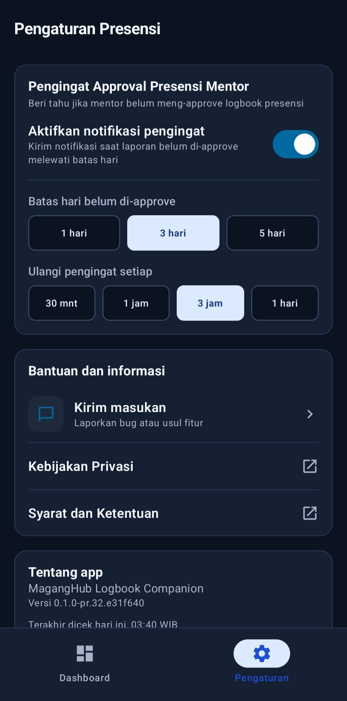
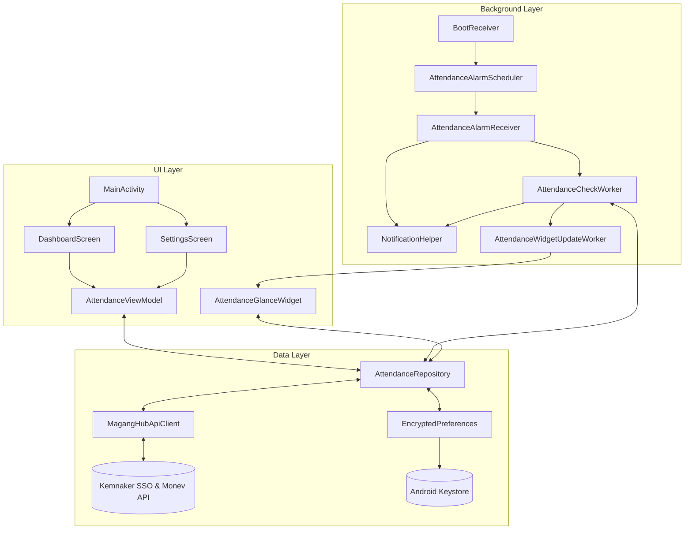

# MagangHub Logbook Companion

[](https://github.com/Churma16/maganghub-logbook-companion/actions/workflows/build-apk.yml)
[-brightgreen.svg)](https://developer.android.com)
[](https://kotlinlang.org)
[](https://developer.android.com/jetpack/compose)
[](https://developer.android.com/jetpack/androidx/releases/glance)
[](https://m3.material.io)
[](LICENSE)
[](https://github.com/Churma16/maganghub-logbook-companion/releases)

Aplikasi Android untuk membantu peserta MagangHub Kemnaker memantau presensi dan mengingatkan pengisian logbook harian.
Cek status presensi langsung dari home screen, atur pengingat sore, dan pantau laporan yang masih menunggu persetujuan mentor. Semuanya bisa dilakukan dari satu aplikasi, tanpa perlu membuka dashboard Monev setiap kali ingin mengecek status.

> [!IMPORTANT]
> **Catatan Versi Beta (v0.x)**  
> MagangHub Logbook Companion saat ini berada pada tahap **Public Beta**. Meskipun seluruh fitur pengingat, widget, dan pemantauan telah diuji dan berjalan stabil, aplikasi ini masih dalam pengembangan aktif. Kami tetap menyarankan peserta untuk sesekali memastikan status logbook dan kehadiran langsung di portal resmi SiapKerja / Monev Kemnaker.

---

## Tampilan Aplikasi

| Dashboard & Status Harian | Pengaturan Presensi | Pengingat Approval Mentor |
|:---:|:---:|:---:|
|  |  |  |

<br/>

### Widget Home Screen

Cek status presensi dan approval mentor langsung dari home screen.

<p align="center">
  
</p>

---

## Kenapa Membuat Aplikasi Ini?

Mengisi logbook merupakan salah satu rutinitas peserta MagangHub. Karena batas pengisiannya sampai pukul 23:59 WIB, terkadang ada saja hari ketika kita lupa mengisi laporan, apalagi setelah seharian bekerja.

Masalahnya, lupa mengisi logbook bisa berdampak pada pencatatan kehadiran dan uang saku.

MagangHub Logbook Companion dibuat untuk membantu mengurangi risiko tersebut. Aplikasi akan memeriksa status presensi, menampilkan informasi yang relevan, dan mengirim pengingat ketika laporan harian belum diselesaikan.

Aplikasi ini juga menyediakan widget agar status presensi bisa dilihat tanpa harus membuka aplikasi.

---

## Fitur

### 1. Dashboard dan status harian
Dashboard menampilkan informasi sesuai waktu dan kondisi presensi:
* **Pra-kerja**: informasi waktu mulai kerja dan jadwal pengingat.
* **Jam kerja**: status dan sisa waktu kerja.
* **Waktu pelaporan**: periode pengingat untuk mengisi logbook dan presensi, mulai pukul 16:00 sampai 23:59 WIB.
* **Selesai**: informasi ketika kewajiban harian sudah terpenuhi.
* **Hari libur**: mengenali akhir pekan dan tanggal libur berdasarkan data Monev.

Jam mulai kerja dapat diubah melalui pengaturan. Default-nya pukul 08:00 WIB.

### 2. Widget home screen
Tidak perlu membuka aplikasi hanya untuk mengecek presensi.
Widget menampilkan:
* Status presensi hari ini.
* Status laporan dan approval mentor.
* Jadwal pengingat berikutnya.
* Waktu sinkronisasi terakhir.
* Tombol refresh untuk mengambil status terbaru.
* Pintasan untuk membuka aplikasi.

Widget tersedia dalam dua ukuran, yaitu 1x3 dan 1x5, serta menyesuaikan tampilannya dengan ruang yang tersedia.

Warna digunakan untuk membedakan status:
* 🟢 **Hijau**: sudah presensi dan logbook selesai.
* 🔵 **Biru**: jam kerja sedang berlangsung.
* 🟠 **Oranye**: belum presensi hari ini.
* 🔴 **Merah**: presensi terlewat atau waktu pengisian mendesak.
* 🟣 **Ungu**: hari libur atau akhir pekan.
* ⚪ **Abu-abu**: pra-kerja atau sesi telah berakhir.

### 3. Pengingat presensi
Pengingat aktif pada periode pukul 16:00–23:59 WIB.
Beberapa hal yang bisa diatur:
* Jam mulai pengingat.
* Interval pengingat: 15, 30, 45, atau 60 menit.
* Tunda pengingat selama 30 menit.
* Cek ulang status presensi dari notifikasi.

Aplikasi menggunakan Android AlarmManager untuk menjadwalkan alarm dan WorkManager sebagai mekanisme pengecekan tambahan.
Setelah presensi terdeteksi selesai, pengingat untuk hari tersebut akan dihentikan.

### 4. Pantau approval mentor
Laporan yang sudah dikirim belum tentu langsung disetujui mentor.
Aplikasi menampilkan laporan yang masih menunggu approval, termasuk berapa lama laporan tersebut belum diproses.
Kamu juga bisa menentukan kapan ingin diingatkan kembali, dengan pilihan:
* 1 hari.
* 3 hari.
* 5 hari.

Jika laporan masih belum disetujui setelah melewati batas yang dipilih, aplikasi akan mengirimkan notifikasi pengingat.

### 5. Notifikasi dan tindakan cepat
Notifikasi tidak hanya berfungsi sebagai pengingat. Ada beberapa tindakan yang bisa dilakukan langsung dari notifikasi:
* **Buka Monev**: membuka dashboard Monev melalui browser.
* **Cek ulang**: mengambil status presensi terbaru.
* **Tunda 30 menit**: menjadwalkan ulang pengingat.

Aplikasi juga memberikan notifikasi ketika presensi sudah terdeteksi selesai.

### 6. Login SIAPkerja dan sinkronisasi data
Aplikasi menggunakan alur autentikasi SSO SIAPkerja Kemnaker untuk mengakses data Monev.
Proses autentikasi meliputi:
1. Meminta URL autentikasi dari MagangHub API.
2. Membuka halaman SSO dan menangani cookie serta CSRF token.
3. Mengirim kredensial melalui proses login resmi.
4. Menukarkan authorization code dengan access token Monev.

Jika token kedaluwarsa, aplikasi akan mencoba melakukan autentikasi ulang.

Ada beberapa mekanisme tambahan untuk menangani kegagalan request:
* Mengikuti `Retry-After` ketika server memberikan HTTP 429.
* Menggunakan jitter pada interval request.
* Menghentikan percobaan otomatis setelah tiga kegagalan berturut-turut.

Kredensial dan token disimpan menggunakan enkripsi AES-256 GCM melalui Android Keystore.

### 7. Tampilan dan pengaturan
Antarmuka menggunakan Jetpack Compose dan Material 3.
Pengaturan yang tersedia:
* Tema terang, gelap, atau mengikuti sistem.
* Jam mulai kerja.
* Jam mulai pengingat.
* Interval notifikasi.
* Pengingat approval mentor.
* Tes notifikasi untuk memastikan izin perangkat sudah aktif.

---

## Download dan Instalasi

APK tersedia melalui halaman [GitHub Releases](../../releases).

Ada tiga jenis build yang tersedia:
1. **Official Release (`maganghub-companion-v<version>.apk`)**: build stabil resmi untuk penggunaan sehari-hari.
2. **Snapshot Pre-Release (`maganghub-companion-v<version>-snapshot.<sha>.apk`)**: dibuat otomatis setiap ada commit baru di branch `main`.
3. **PR Preview Build**: APK pratinjau saat PR diberi label `build-preview`.

### Cara instalasi
1. Buka halaman GitHub Releases.
2. Pilih versi yang ingin dipasang.
3. Unduh file APK.
4. Buka APK melalui File Manager.
5. Jika diminta, izinkan instalasi aplikasi dari sumber tersebut.
6. Lanjutkan instalasi.

> **Catatan**: aplikasi membutuhkan Android 8.0 (API 26) atau lebih baru.

---

## Pengaturan Android

Android memiliki mekanisme pengelolaan baterai yang dapat membatasi aktivitas aplikasi di latar belakang. Beberapa produsen juga menerapkan pembatasan tambahan.

Agar pengingat dapat berjalan lebih konsisten, periksa pengaturan berikut:
* **Izin notifikasi**: Izinkan notifikasi ketika aplikasi pertama kali dijalankan. Pada Android 13 ke atas, izin ini perlu diberikan secara eksplisit.
* **Exact Alarm**: Pada Android 12 ke atas, aktifkan izin alarm tepat waktu melalui pengaturan aplikasi jika diminta.
* **Penggunaan baterai**: Jika perangkat sering menghentikan aplikasi di latar belakang, ubah pengaturan baterai MagangHub menjadi *Unrestricted* atau *Tidak Dibatasi*.
* **Autostart**: Pada beberapa perangkat Xiaomi, OPPO, dan vivo, aktifkan fitur *Autostart* jika tersedia.

*Nama dan lokasi pengaturan dapat berbeda tergantung versi Android dan antarmuka masing-masing produsen.*

---

## Untuk Developer

### Teknologi yang Digunakan
* **Kotlin**: 1.9.23
* **UI**: Jetpack Compose (BOM 2024.04.01) & Material 3
* **Widget**: Jetpack Glance 1.1.0
* **Background Tasks**: Android AlarmManager (`setAlarmClock`) & WorkManager 2.9.0
* **Networking**: OkHttp 4.12.0
* **Security**: Androidx Security Crypto (AES-256 GCM EncryptedSharedPreferences via Android Keystore)
* **Testing**: JUnit 4, Kotlinx Coroutines Test, MockWebServer, Robolectric

### Arsitektur
Aplikasi memisahkan antarmuka, pengelolaan data, dan proses background agar masing-masing bagian memiliki tanggung jawab yang jelas.



### Struktur Direktori

```
app/src/main/
├── AndroidManifest.xml
├── java/id/churma/maganghubcompanion/
│   ├── MagangHubApp.kt
│   ├── background/
│   │   ├── AttendanceAlarmScheduler.kt
│   │   ├── AttendanceAlarmReceiver.kt
│   │   ├── AttendanceCheckWorker.kt
│   │   ├── BootReceiver.kt
│   │   └── NotificationHelper.kt
│   ├── data/
│   │   ├── api/
│   │   │   ├── MagangHubApiClient.kt
│   │   │   ├── InMemoryCookieJar.kt
│   │   │   └── Exceptions.kt
│   │   ├── model/
│   │   │   ├── AttendanceHomeData.kt
│   │   │   ├── AttendanceStatus.kt
│   │   │   └── UserSession.kt
│   │   ├── repository/
│   │   │   ├── AttendanceRepository.kt
│   │   │   └── AttendanceRepositoryImpl.kt
│   │   └── storage/
│   │       └── EncryptedPreferences.kt
│   ├── ui/
│   │   ├── MainActivity.kt
│   │   ├── components/
│   │   ├── screens/
│   │   ├── theme/
│   │   └── viewmodel/
│   │       ├── AttendanceViewModel.kt
│   │       └── AttendanceUiState.kt
│   └── widget/
│       ├── AttendanceGlanceWidget.kt
│       ├── AttendanceWidgetReceiver.kt
│       ├── AttendanceWidgetUpdateWorker.kt
│       └── WidgetTheme.kt
└── res/
    ├── layout/
    │   └── widget_attendance_preview.xml
    └── xml/
        └── attendance_widget_info.xml
```

### Menjalankan Project

#### Prasyarat
* JDK 17
* Android SDK 34
* Gradle 8.7 (sudah tersedia melalui Gradle Wrapper)

#### Perintah Build Terminal

```bash
# Clone repository
git clone https://github.com/Churma16/maganghub-logbook-companion.git
cd maganghub-logbook-companion
chmod +x gradlew

# Menjalankan unit test
./gradlew testDebugUnitTest

# Build Debug APK
./gradlew assembleDebug

# Build Release APK
./gradlew assembleRelease

# Build Snapshot
./gradlew assembleRelease -PversionSuffix="-snapshot.abc1234"
```

Hasil build tersedia di:
* `app/build/outputs/apk/debug/`
* `app/build/outputs/apk/release/`

---

## Keamanan dan Privasi

Aplikasi menyimpan data autentikasi secara lokal dan tidak menggunakan server perantara untuk mengakses akun.

Beberapa hal yang perlu diketahui:
* Password dan token disimpan menggunakan enkripsi AES-256 GCM melalui Android Keystore.
* Request dikirim langsung ke layanan SIAPkerja dan MagangHub Kemnaker.
* Tidak menggunakan layanan analitik pihak ketiga.
* Tidak menampilkan iklan.
* Tidak memiliki server backend milik proyek untuk menyimpan kredensial pengguna.

Endpoint yang digunakan:
* SSO Kemnaker: `https://siapkerja.kemnaker.go.id/auth/login`
* API MagangHub: `https://monev-api.maganghub.kemnaker.go.id/api/v1`

> **Catatan**: aplikasi ini merupakan proyek independen, bukan aplikasi resmi Kemnaker. Pengguna tetap perlu memastikan status presensi dan logbook melalui portal resmi Monev.

---

## Siklus Rilis

Repository menggunakan Semantic Versioning dan GitHub Actions untuk mengelola versi aplikasi.

### Pull Request
Perubahan fitur dan perbaikan bug tidak perlu mengubah `versionCode` atau `versionName` secara manual.

Commit mengikuti [Conventional Commits](https://www.conventionalcommits.org/):
* `feat:` — fitur baru (menaikkan versi Minor).
* `fix:` — perbaikan bug (menaikkan versi Patch).
* `BREAKING CHANGE:` — perubahan besar yang merusak kompatibilitas (menaikkan versi Major).
* `chore:`, `docs:`, `style:`, `refactor:`, `test:` — pemeliharaan rutin tanpa kenaikan versi rilis.

Validasi versi dilakukan secara otomatis oleh `verify-no-manual-version-bump.js`.

### Snapshot Release
Setiap perubahan yang masuk ke branch `main` akan memicu workflow snapshot.
Jika test dan build berhasil, APK snapshot akan dipublikasikan melalui GitHub Pre-Releases.
Format nama file: `maganghub-companion-v<version>-snapshot.<sha>.apk`.

### Official Release
Rilis stabil dilakukan secara manual melalui GitHub Actions (`workflow_dispatch`).
Workflow akan:
1. Membaca commit sejak rilis stabil terakhir.
2. Menentukan jenis perubahan dan kenaikan versi.
3. Memperbarui `CHANGELOG.md`.
4. Membuat Git tag.
5. Build APK release.
6. Mempublikasikan GitHub Release resmi.

---

## CI/CD

Ada beberapa workflow yang digunakan untuk mengotomatisasi proses build dan rilis:
* **CI Verification (`build-apk.yml`)**: memeriksa unit test Node.js untuk script rilis, validasi aturan versioning PR, unit test Android (`./gradlew testDebugUnitTest`), dan build APK sesuai konfigurasi.
* **Snapshot Release (`snapshot-release.yml`)**: berjalan otomatis saat push ke `main` untuk menguji dan mempublikasikan pre-release snapshot.
* **Manual Release (`manual-release.yml`)**: menerbitkan rilis stabil resmi via `workflow_dispatch`.
* **PR Preview Build (`preview-build.yml`)**: mengompilasi APK pratinjau saat PR diberi label `build-preview`.
* **Cleanup Preview (`cleanup-preview.yml`)**: membersihkan aset pre-release preview saat PR di-merge atau ditutup.

---

## Lisensi

Proyek ini menggunakan lisensi [MIT](LICENSE).
