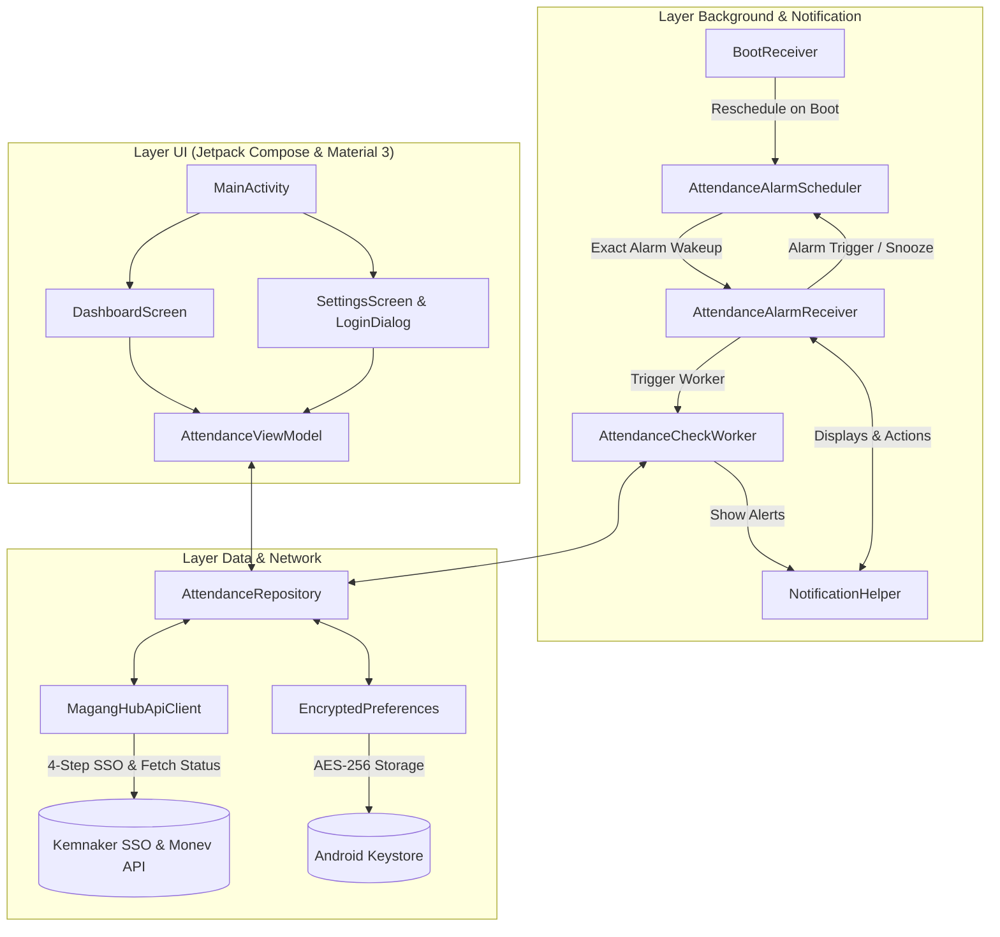

# 🚀 MagangHub Android

[](https://github.com/maganghub/maganghub-android/actions/workflows/build-apk.yml)
[-brightgreen.svg)](https://developer.android.com)
[](https://kotlinlang.org)
[](https://developer.android.com/jetpack/compose)
[](https://m3.material.io)
[](LICENSE)

> **Asisten Pengingat & Pemantau Presensi MagangHub Kemnaker Otomatis untuk Android**  
> Mengeliminasi risiko lupa mengisi presensi dan logbook harian dengan spam reminders cerdas pukul **16:00 – 23:59 WIB**.

---

## 📋 Daftar Isi
1. [Latar Belakang](#-latar-belakang)
2. [Fitur Utama](#-fitur-utama)
3. [Arsitektur Aplikasi](#-arsitektur-aplikasi)
4. [Download & Cara Instalasi APK](#-download--cara-instalasi-apk)
5. [Panduan Pengaturan di Android (Anti-Kill OS)](#-panduan-pengaturan-di-android-anti-kill-os)
6. [Kompilasi & Build dari Source Code](#-kompilasi--build-dari-source-code)
7. [Keamanan & Privasi Kredensial](#-keamanan--privasi-kredensial)
8. [CI/CD Workflow](#-cicd-workflow)

---

## 🎯 Latar Belakang

Bagi peserta program magang bersertifikat Kementerian Ketenagakerjaan Republik Indonesia (Kemnaker) di portal **MagangHub Monev**, pengisian presensi kehadiran dan logbook harian memiliki batas waktu ketat setiap harinya hingga **23:59 WIB**. Jika terlewat satu hari saja, presensi berstatus alpha/tidak hadir dan tidak dapat disusul kembali.

**MagangHub Android** memporting kehandalan bot pemantau Go backend (`maganghub-checker-bot`) menjadi aplikasi mobile Android mandiri yang ringan, hemat daya, dan tahan banting terhadap Doze Mode sistem operasi Android modern.

---

## ✨ Fitur Utama

### 1. ⏰ Dual-Engine Background Scheduler (16:00 – 23:59 WIB)
* **AlarmManager Exact Receiver (`RTC_WAKEUP`)**: Menggunakan `setAlarmClock` yang dijamin oleh sistem Android untuk menembus Doze Mode pada jam pengingat tanpa tertunda oleh deep sleep perangkat.
* **WorkManager Periodic Safety Net**: Menjalankan pengecekan periodik berbasis batasan jaringan (`NetworkType.CONNECTED`) sebagai lapis cadangan jika AlarmManager dibatasi oleh sistem.
* **Boot & Package Update Receiver**: Otomatis mendaftarkan dan menjadwalkan ulang alarm segera setelah smartphone dinyalakan ulang (`BOOT_COMPLETED`) atau setelah pembaruan aplikasi (`MY_PACKAGE_REPLACED`).
* **Siklus Libur Cerdas**: Otomatis mendeteksi hari libur nasional atau jadwal libur mingguan (`is_holiday` / `is_scheduled_off_day`) dan tidak akan mengganggu Anda di hari libur.
* **Auto-Mute Pasca-Absen**: Segera setelah Anda mengisi presensi, scheduler langsung menonaktifkan pengingat hari itu dan tidur lelap hingga jadwal esok hari pukul 16:00 WIB.

### 2. 🔔 Notifikasi Prioritas Tinggi & Quick Actions
* **High-Priority Channel**: Notifikasi muncul dengan status heads-up banner disertai suara dan pola getaran khas.
* **Quick Action Buttons Langsung di Notifikasi**:
  * 🌐 **Buka Monev**: Membuka dashboard presensi Monev MagangHub langsung di browser default hanya dengan satu sentuhan.
  * 🔄 **Cek Ulang**: Memeriksa ulang status ke server Kemnaker di latar belakang tanpa harus membuka aplikasi.
  * ⏱️ **Snooze 30 Menit**: Menunda notifikasi berikutnya selama 30 menit jika Anda sedang di jalan atau rapat.
* **Notifikasi Konfirmasi Harian**: Ucapan selamat sekali sehari ketika presensi berhasil diverifikasi sudah masuk.

### 3. 🛡️ Otentikasi SIAPkerja Kemnaker SSO 4-Tahap
* Porting lengkap otomasi autentikasi dari Go:
  1. `GET /auth/login` MagangHub API untuk mendapatkan URL autorisasi SSO.
  2. `GET SSO authorization page` dengan penanganan cookie sesi dan ekstraksi `csrf-token`.
  3. `POST /auth/login` kredensial akun Kemnaker dengan header `X-CSRF-TOKEN` dan penangkapan kode otorisasi via HTTP 302 Location.
  4. `GET /auth/login/callback` penukaran authorization code dengan Bearer token Monev.
* **Transparan Auto Re-Login**: Jika token sesi kedaluwarsa (HTTP 401), aplikasi otomatis memperbarui token tanpa mengganggu pengguna.
* **Encrypted Storage**: Kredensial akun dan token disimpan secara aman menggunakan enkripsi AES-256 hardware Keystore (`EncryptedSharedPreferences`).

### 4. 🎨 Modern Jetpack Compose & Material 3 UI
* Palet warna adaptif: Emerald Green tenang untuk status "Sudah Absen", Amber/Coral tegas untuk status "Belum Absen".
* Status card real-time dengan countdown/waktu pengingat berikutnya.
* Mode pengaturan lengkap: ubah jam mulai pengingat (default: 16:00 WIB), interval peringatan (default: 30 menit), serta toggle suara dan getar.
* Tombol uji notifikasi instan untuk memastikan konfigurasi channel berjalan baik di perangkat Anda.

---

## 🏗️ Arsitektur Aplikasi

Aplikasi dibangun dengan prinsip **Clean Architecture** dan pola **MVVM (Model-View-ViewModel)** modern:



### Struktur Direktori

```
app/src/main/
├── AndroidManifest.xml
├── java/id/codes/maganghub/
│   ├── MagangHubApp.kt                     # Application class & DI locator
│   ├── background/                         # Subistem Penjadwalan & Notifikasi
│   │   ├── AttendanceAlarmScheduler.kt     # Pengatur jam exact alarm (WIB UTC+7)
│   │   ├── AttendanceAlarmReceiver.kt     # Penerima sinyal alarm & aksi tombol notifikasi
│   │   ├── AttendanceCheckWorker.kt       # CoroutineWorker WorkManager
│   │   ├── BootReceiver.kt                # Penerima BOOT_COMPLETED setelah restart
│   │   └── NotificationHelper.kt          # Kanal notifikasi, layout, & aksi cepat
│   ├── data/                               # Lapisan Data & Jaringan
│   │   ├── api/
│   │   │   ├── MagangHubApiClient.kt      # Klien HTTP & SSO 4-Step Kemnaker
│   │   │   ├── InMemoryCookieJar.kt       # Manajemen cookie sesi redirect SSO
│   │   │   └── Exceptions.kt              # Hierarki exception API & Auth
│   │   ├── model/
│   │   │   ├── AttendanceHomeData.kt      # Model respons endpoint /users/me/home
│   │   │   ├── AttendanceStatus.kt        # Enum status presensi (HADIR, dsb.)
│   │   │   └── UserSession.kt             # Data session & preferensi pengingat
│   │   ├── repository/
│   │   │   ├── AttendanceRepository.kt    # Kontrak repository
│   │   │   └── AttendanceRepositoryImpl.kt# Implementasi sinkronisasi & cache
│   │   └── storage/
│   │       └── EncryptedPreferences.kt    # Enkripsi kredensial AES-256
│   └── ui/                                 # Antarmuka Jetpack Compose
│       ├── MainActivity.kt                # Activity utama aplikasi
│       ├── components/                    # Komponen UI modular
│       ├── screens/                       # DashboardScreen & SettingsScreen
│       ├── theme/                         # Color, Theme, & Typography M3
│       └── viewmodel/
│           ├── AttendanceViewModel.kt     # Logika state UI & handler user
│           └── AttendanceUiState.kt       # State immutability holder
```

---

## 📥 Download & Cara Instalasi APK

### Mengunduh APK Rilis
1. Kunjungi tab **[Releases](../../releases)** pada repositori ini untuk mengunduh versi rilis APK terbaru (`MagangHub-Release.apk`).
2. Atau unduh build APK terbaru dari artefak **[GitHub Actions](../../actions)** pada setiap commit.

### Menginstal di Smartphone Android
1. Transfer atau unduh file `.apk` ke ponsel Android Anda.
2. Buka file `.apk` melalui file manager.
3. Jika muncul peringatan keamanan *"Instal aplikasi dari sumber tidak dikenal"*, pilih **Izinkan untuk sumber ini**.
4. Tekan **Instal** dan tunggu hingga proses pemasangan selesai.

---

## ⚙️ Panduan Pengaturan di Android (Anti-Kill OS)

Sistem operasi seperti **MIUI / HyperOS (Xiaomi)**, **ColorOS (Oppo/Realme)**, **FuntouchOS (Vivo)**, dan **One UI (Samsung)** memiliki manajemen RAM agresif yang dapat membekukan background process. Ikuti langkah berikut agar alarm presensi 100% selalu berbunyi tepat waktu:

1. **Izinkan Notifikasi (Android 13+)**:
   * Saat pertama kali membuka aplikasi, tekan **Allow / Izinkan** saat muncul dialog permintaan izin notifikasi.
2. **Izin Alarm & Pengingat Tepat Waktu (Android 12+)**:
   * Masuk ke *Pengaturan HP* > *Aplikasi* > *MagangHub* > *Alarm & Pengingat* > Aktifkan **Izinkan penyetelan alarm tepat waktu** (*Allow setting exact alarms*).
3. **Penghemat Baterai (Battery Optimization)**:
   * Masuk ke *Pengaturan HP* > *Aplikasi* > *MagangHub* > *Baterai* > Pilih **Tidak Dibatasi / Unrestricted** (Jangan dioptimalkan).
4. **Autostart / Mulai Otomatis (Khusus Xiaomi / Oppo / Vivo)**:
   * Masuk ke info aplikasi MagangHub > Aktifkan toggle **Mulai Otomatis / Autostart**.

---

## 🛠️ Kompilasi & Build dari Source Code

### Prasyarat
* **Java Development Kit (JDK)**: Versi 17 (disarankan Eclipse Temurin atau Oracle OpenJDK 17).
* **Android SDK**: Compile SDK 34, Min SDK 26.
* **Gradle**: 8.7 (disediakan via `gradlew`).

### Perintah Build Terminal

```bash
# Clone repositori
git clone https://github.com/maganghub/maganghub-android.git
cd maganghub-android

# Berikan izin eksekusi wrapper gradle
chmod +x gradlew

# Jalankan Unit Tests
./gradlew testDebugUnitTest

# Build Debug APK
./gradlew assembleDebug

# Build Release APK
./gradlew assembleRelease
```

File APK yang telah berhasil di-compile akan berada di:
* Debug APK: `app/build/outputs/apk/debug/app-debug.apk`
* Release APK: `app/build/outputs/apk/release/app-release.apk`

---

## 🔒 Keamanan & Privasi Kredensial

* **Enkripsi Hardware Keystore**: Password akun Kemnaker tidak disimpan sebagai plain-text, melainkan dienkripsi menggunakan skema AES-256 GCM yang kuncinya dikelola oleh Android Keystore hardware security module.
* **Koneksi Langsung**: Aplikasi hanya berkomunikasi langsung dengan server resmi Kemnaker:
  * SSO Kemnaker: `https://siapkerja.kemnaker.go.id/auth/login`
  * API MagangHub: `https://monev-api.maganghub.kemnaker.go.id/api/v1`
* **Tanpa Server Pihak Ketiga**: Tidak ada analitik pihak ketiga, tidak ada iklan, dan tidak ada server perantara eksternal. Kredensial Anda 100% tetap di perangkat Anda.

---

## 🤖 CI/CD Workflow

Proyek ini telah dikonfigurasi dengan pipeline CI/CD otomatis berbasis GitHub Actions (`.github/workflows/build-apk.yml`):
* **Triggers**: Berjalan otomatis pada setiap push ke branch `main`, pull request, serta pembuatan release tag (`v*`).
* **Automated Steps**:
  1. Setup environment JDK 17 & Gradle Caching.
  2. Eksekusi Unit Test suite (`testDebugUnitTest`).
  3. Kompilasi otomatis `assembleDebug` dan `assembleRelease`.
  4. Pengunggahan APK artifacts ke tab GitHub Actions (tersedia untuk diunduh langsung).
  5. Otomatis mempublikasikan GitHub Release dan melampirkan file APK jika terdeteksi tag rilis (misal `v1.0.0`).

---

## 📄 Lisensi

Didistribusikan di bawah Lisensi **MIT**. Silakan gunakan, pelajari, dan modifikasi sesuai kebutuhan program magang Anda.
