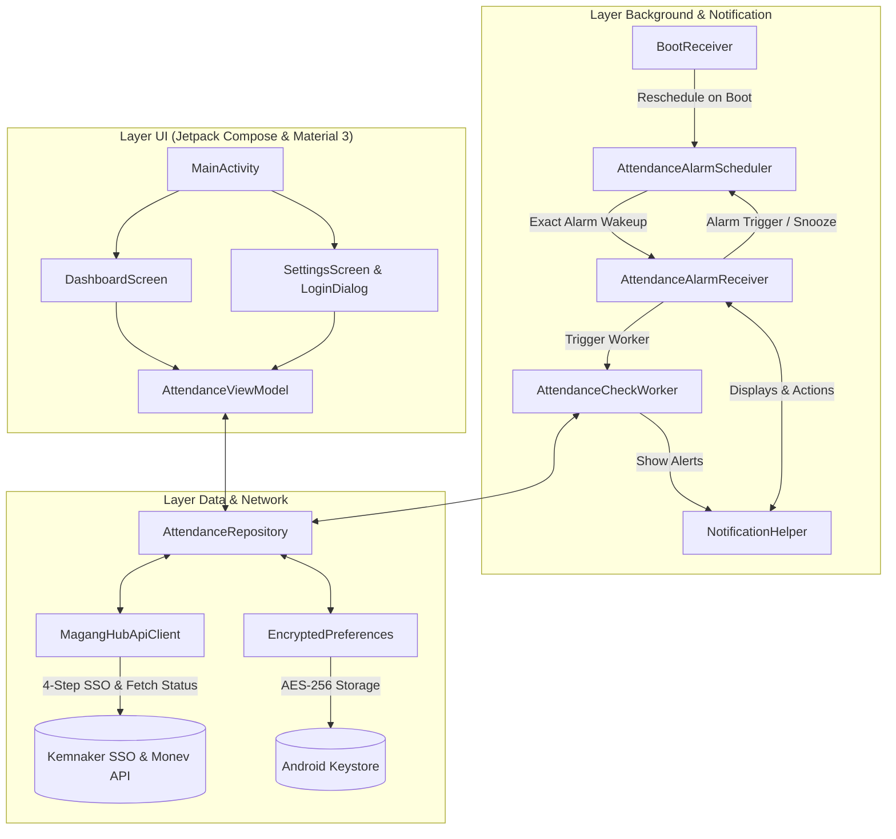

# MagangHub Logbook Companion

[](https://github.com/Churma16/maganghub-logbook-companion/actions/workflows/build-apk.yml)
[-brightgreen.svg)](https://developer.android.com)
[](https://kotlinlang.org)
[](https://developer.android.com/jetpack/compose)
[](https://m3.material.io)
[](LICENSE)

Aplikasi Android pengingat presensi dan pengisian logbook harian untuk peserta MagangHub Kemnaker (Monev). Aplikasi ini mengecek status kehadiran secara berkala dan membunyikan alarm pengingat antara pukul 16:00 sampai 23:59 WIB jika kamu belum mengisi presensi hari ini.

---

## Daftar Isi
1. [Latar Belakang](#latar-belakang)
2. [Fitur Utama](#fitur-utama)
3. [Arsitektur Aplikasi](#arsitektur-aplikasi)
4. [Download dan Cara Pasang APK](#download-dan-cara-pasang-apk)
5. [Pengaturan Agar Tidak Dimatikan OS (Anti-Kill)](#pengaturan-agar-tidak-dimatikan-os-anti-kill)
6. [Kompilasi dari Source Code](#kompilasi-dari-source-code)
7. [Keamanan dan Privasi Kredensial](#keamanan-dan-privasi-kredensial)
8. [Siklus Rilis dan Versioning](#siklus-rilis-dan-versioning)
9. [CI/CD Workflow](#cicd-workflow)
10. [Lisensi](#lisensi)

---

## Latar Belakang

Bagi peserta program magang bersertifikat Kementerian Ketenagakerjaan Republik Indonesia (Kemnaker) di portal MagangHub Monev, pengisian presensi dan laporan kegiatan harian wajib diselesaikan paling lambat pukul 23:59 WIB setiap hari kerja. Jika terlewat, sistem mencatat status tidak hadir (alpa) dan tidak ada mekanisme susulan.

MagangHub Logbook Companion memindahkan logika pemantau presensi mandiri ke aplikasi mobile Android. Aplikasi berjalan langsung di perangkat pengguna tanpa server perantara, hemat baterai, dan tetap bisa memicu alarm tepat waktu meskipun ponsel berada dalam kondisi Doze mode.

---

## Fitur Utama

### 1. Penjadwal Pengingat Sore dan Malam (16:00 - 23:59 WIB)
* **AlarmManager Exact Clock (`RTC_WAKEUP`)**: Menggunakan `setAlarmClock` yang diizinkan sistem Android untuk menembus Doze mode pada jam yang sudah ditentukan tanpa tertunda oleh deep sleep perangkat.
* **WorkManager Periodic Safety Net**: Pengecekan cadangan berbasis koneksi jaringan aktif (`NetworkType.CONNECTED`) jika AlarmManager dibatasi oleh sistem.
* **Boot dan Update Receiver**: Menjadwalkan ulang alarm otomatis setelah ponsel dinyalakan ulang (`BOOT_COMPLETED`) atau setelah aplikasi diperbarui (`MY_PACKAGE_REPLACED`).
* **Pengecekan Hari Libur**: Otomatis mendeteksi hari libur nasional atau jadwal libur mingguan dari data Monev, sehingga tidak akan memicu alarm di hari libur.
* **Auto-Mute Setelah Absen**: Begitu presensi hari ini terdeteksi sudah diisi, alarm pengingat hari itu langsung berhenti dan dijadwalkan kembali untuk besok sore pukul 16:00 WIB.

### 2. Notifikasi Prioritas Tinggi dan Aksi Cepat
* **Kanal Notifikasi Prioritas Tinggi**: Notifikasi muncul di bagian atas layar (heads-up banner) disertai suara dan getar.
* **Tombol Aksi Cepat pada Notifikasi**:
  * **Buka Monev**: Membuka dashboard Monev MagangHub langsung di browser bawaan ponsel.
  * **Cek Ulang**: Memeriksa ulang status kehadiran ke server Kemnaker di latar belakang tanpa membuka aplikasi.
  * **Tunda 30 Menit**: Menunda jadwal alarm pengingat berikutnya selama 30 menit.
* **Konfirmasi Harian**: Menampilkan notifikasi pemberitahuan saat kehadiran berhasil diverifikasi sudah masuk.

### 3. Autentikasi SIAPkerja Kemnaker SSO 4-Tahap
* Menangani alur login SSO resmi:
  1. `GET /auth/login` MagangHub API untuk mendapatkan URL autorisasi SSO Kemnaker.
  2. `GET SSO authorization page` dengan penanganan cookie sesi dan pengambilan `csrf-token`.
  3. `POST /auth/login` kredensial akun Kemnaker dengan header `X-CSRF-TOKEN` dan penangkapan authorization code via redirect HTTP 302.
  4. `GET /auth/login/callback` penukaran authorization code dengan Bearer token Monev.
* **Pembaruan Sesi Otomatis**: Jika token sesi kedaluwarsa (HTTP 401), aplikasi otomatis memperbarui token di latar belakang.
* **Ketahanan Rate Limit dan Anti-Ban**:
  * Menggunakan User-Agent mobile Android yang wajar untuk menjaga konsistensi trafik.
  * Mendukung parser `Retry-After` saat menerima respons HTTP 429 dan menjadwalkan ulang alarm sesuai durasi jeda yang diminta server.
  * Menerapkan variasi acak (jitter) pada interval pengingat dan seed acak perangkat agar trafik ribuan pengguna tidak membanjiri server Kemnaker pada menit yang persis sama.
  * Memasang circuit breaker yang menangguhkan auto-login setelah 3 kali gagal autentikasi berturut-turut demi melindungi akun dari pemblokiran brute-force SSO.
* **Penyimpanan Terenkripsi**: Password dan token disimpan menggunakan enkripsi AES-256 hardware Keystore (`EncryptedSharedPreferences`).

### 4. Tampilan Jetpack Compose dan Material 3
* Status kehadiran jelas: indikator visual tegas untuk status sudah absen atau belum absen.
* Kartu informasi real-time: menampilkan tanggal, status laporan harian, dan jadwal pengingat berikutnya.
* Pengaturan lengkap: atur jam mulai pengingat (bawaan: 16:00 WIB), interval alarm (bawaan: 30 menit), serta toggle suara dan getar.
* Tombol uji notifikasi instan untuk memastikan perizinan kanal notifikasi di ponsel berfungsi dengan baik.

---

## Arsitektur Aplikasi

Aplikasi dibangun dengan arsitektur terpisah antara tampilan, logika background, dan jaringan:



### Struktur Direktori

```
app/src/main/
├── AndroidManifest.xml
├── java/id/codes/maganghub/
│   ├── MagangHubApp.kt                     # Application class & DI locator
│   ├── background/                         # Penjadwalan & Notifikasi
│   │   ├── AttendanceAlarmScheduler.kt     # Pengatur jam exact alarm (WIB UTC+7)
│   │   ├── AttendanceAlarmReceiver.kt     # Penerima sinyal alarm & aksi tombol notifikasi
│   │   ├── AttendanceCheckWorker.kt       # CoroutineWorker WorkManager
│   │   ├── BootReceiver.kt                # Penerima BOOT_COMPLETED setelah restart
│   │   └── NotificationHelper.kt          # Kanal notifikasi, layout, & aksi cepat
│   ├── data/                               # Data & Jaringan
│   │   ├── api/
│   │   │   ├── MagangHubApiClient.kt      # Klien HTTP & SSO 4-Step Kemnaker
│   │   │   ├── InMemoryCookieJar.kt       # Manajemen cookie sesi redirect SSO
│   │   │   └── Exceptions.kt              # Hierarki exception API & Auth
│   │   ├── model/
│   │   │   ├── AttendanceHomeData.kt      # Model respons endpoint /users/me/home
│   │   │   ├── AttendanceStatus.kt        # Enum status presensi (HADIR, dsb.)
│   │   │   └── UserSession.kt             # Data session & preferensi pengingat
│   │   ├── repository/
│   │   │   ├── AttendanceRepository.kt    # Kontrak repository
│   │   │   └── AttendanceRepositoryImpl.kt# Implementasi sinkronisasi & cache
│   │   └── storage/
│   │       └── EncryptedPreferences.kt    # Enkripsi kredensial AES-256
│   └── ui/                                 # Antarmuka Jetpack Compose
│       ├── MainActivity.kt                # Activity utama aplikasi
│       ├── components/                    # Komponen UI modular
│       ├── screens/                       # DashboardScreen & SettingsScreen
│       ├── theme/                         # Color, Theme, & Typography M3
│       └── viewmodel/
│           ├── AttendanceViewModel.kt     # Logika state UI & handler user
│           └── AttendanceUiState.kt       # State immutability holder
```

---

## Download dan Cara Pasang APK

### Pilihan Unduhan APK
1. **Official Release APK (`maganghub-v<version>.apk`)**:
   - Unduh file APK rilis stabil dari halaman [GitHub Releases](../../releases).
   - Direkomendasikan untuk penggunaan sehari-hari.
2. **Snapshot Pre-Release APK (`maganghub-v<version>-snapshot.<sha>.apk`)**:
   - Dibuat otomatis setiap ada commit yang masuk ke branch `main`.
   - Berguna untuk menguji perbaikan terbaru sebelum rilis resmi keluar.
3. **Preview APK Pull Request**:
   - Tersedia saat pengembang memasang label `build-preview` atau menjalankan build preview secara manual di PR.

### Cara Memasang di Ponsel Android
1. Unduh file `.apk` ke ponsel Android kamu.
2. Buka file `.apk` lewat File Manager atau browser download.
3. Jika muncul dialog peringatan instalasi dari sumber luar, masuk ke **Setelan / Settings** lalu aktifkan opsi **Izinkan dari sumber ini**.
4. Tekan **Instal** dan tunggu proses pemasangan selesai.

---

## Pengaturan Agar Tidak Dimatikan OS (Anti-Kill)

Sistem antarmuka Android seperti MIUI / HyperOS (Xiaomi), ColorOS (Oppo/Realme), FuntouchOS (Vivo), dan One UI (Samsung) memiliki manajemen baterai ketat yang sering mematikan proses background. Terapkan pengaturan berikut agar alarm presensi tetap andal berbunyi tepat waktu:

1. **Izinkan Notifikasi (Android 13 ke atas)**:
   * Saat pertama kali membuka aplikasi, pilih **Izinkan / Allow** pada dialog permintaan izin notifikasi.
2. **Izin Alarm Tepat Waktu (Android 12 ke atas)**:
   * Masuk ke *Pengaturan HP* > *Aplikasi* > *MagangHub* > *Alarm & Pengingat* > Aktifkan **Izinkan penyetelan alarm tepat waktu**.
3. **Penghemat Baterai (Battery Optimization)**:
   * Masuk ke *Pengaturan HP* > *Aplikasi* > *MagangHub* > *Baterai* > Pilih **Tidak Dibatasi / Unrestricted**.
4. **Mulai Otomatis / Autostart (Khusus Xiaomi, Oppo, Vivo)**:
   * Buka info aplikasi MagangHub > Aktifkan opsi **Mulai Otomatis / Autostart**.

---

## Kompilasi dari Source Code

### Prasyarat
* **Java Development Kit (JDK)**: Versi 17 (disarankan Eclipse Temurin atau OpenJDK 17).
* **Android SDK**: Compile SDK 34, Min SDK 26.
* **Gradle**: 8.7 (disediakan via wrapper `gradlew`).

### Perintah Build Terminal

```bash
# Clone repositori
git clone https://github.com/Churma16/maganghub-logbook-companion.git
cd maganghub-logbook-companion

# Berikan izin eksekusi wrapper gradle
chmod +x gradlew

# Jalankan Unit Tests
./gradlew testDebugUnitTest

# Build Debug APK (output: app/build/outputs/apk/debug/maganghub-v1.0.0-dev.apk)
./gradlew assembleDebug

# Build Signed Release APK (output: app/build/outputs/apk/release/maganghub-v1.0.0.apk)
./gradlew assembleRelease

# Build Snapshot APK dengan Version Suffix
./gradlew assembleRelease -PversionSuffix="-snapshot.abc1234"
```

Lokasi file APK hasil kompilasi:
* Debug APK: `app/build/outputs/apk/debug/maganghub-v<version>-dev.apk`
* Release APK: `app/build/outputs/apk/release/maganghub-v<version>.apk`

---

## Keamanan dan Privasi Kredensial

* **Enkripsi Hardware Keystore**: Password akun Kemnaker tidak disimpan sebagai teks polos, melainkan dienkripsi dengan AES-256 GCM yang kuncinya dikelola oleh Android Keystore hardware security module.
* **Koneksi Langsung**: Aplikasi hanya berkomunikasi langsung dengan server resmi Kemnaker:
  * SSO Kemnaker: `https://siapkerja.kemnaker.go.id/auth/login`
  * API MagangHub: `https://monev-api.maganghub.kemnaker.go.id/api/v1`
* **Tanpa Server Perantara**: Tidak ada pelacak analitik pihak ketiga, tidak ada iklan, dan tidak ada server eksternal perantara. Seluruh kredensial tetap berada di dalam perangkat pengguna.

---

## Siklus Rilis dan Versioning

Repositori ini menerapkan siklus rilis berbasis GitHub Actions dan Semantic Versioning:

### 1. Pengembangan dan Pull Request (PR)
* Jangan mengubah nilai `versionCode` atau `versionName` di `app/build.gradle.kts` secara manual di PR fitur atau perbaikan.
* Gunakan format commit konvensional:
  * `feat:` — Fitur baru (menaikkan versi Minor, misal `1.0.0` ke `1.1.0`).
  * `fix:` — Perbaikan bug (menaikkan versi Patch, misal `1.0.0` ke `1.0.1`).
  * `BREAKING CHANGE:` — Perubahan struktural breaking (menaikkan versi Major).
  * `chore:`, `docs:`, `style:`, `refactor:`, `test:` — Perawatan rutin tanpa menaikkan versi rilis.
* Script `verify-no-manual-version-bump.js` memverifikasi aturan versi di setiap PR secara otomatis.

### 2. Snapshot Builds (Otomatis saat Merge ke `main`)
* Setiap commit yang masuk ke branch `main` secara otomatis memicu workflow Snapshot Pre-Release.
* Gradle mengompilasi APK pratinjau `maganghub-v<version>-snapshot.<sha>.apk` dan mempublikasikannya sebagai GitHub Pre-Release.

### 3. Rilis Resmi (Manual Workflow Dispatch)
* Rilis resmi diterbitkan melalui workflow Manual Release pada tab GitHub Actions.
* Workflow membaca seluruh commit sejak rilis stabil terakhir, menentukan tipe bump SemVer, memperbarui `CHANGELOG.md`, membuat git tag versi baru, mengompilasi release APK, dan mempublikasikan GitHub Release resmi.

---

## CI/CD Workflow

* **CI Verification (`.github/workflows/build-apk.yml`)**:
  1. Validasi skrip rilis dengan unit test Node.js (`tests/releaseScripts.test.js`).
  2. Pengecekan guardrail versi PR (`verify-no-manual-version-bump.js`).
  3. Setup JDK 17 dan Gradle caching.
  4. Eksekusi unit test dan linting Android (`./gradlew testDebugUnitTest`).
  5. Kompilasi signed APK berjalan on-demand hanya jika PR memiliki label `build-apk` atau dipicu via `workflow_dispatch`.
* **Snapshot Release (`.github/workflows/snapshot-release.yml`)**:
  - Berjalan otomatis saat ada push/merge ke `main`, membuat rilis snapshot, dan mengunggah APK.
* **Manual Release (`.github/workflows/manual-release.yml`)**:
  - Dijalankan manual (`workflow_dispatch`) untuk menerbitkan versi rilis stabil resmi.
* **PR Preview Build (`.github/workflows/preview-build.yml`)**:
  - Dijalankan on-demand saat PR diberi label `build-preview` untuk menghasilkan APK pratinjau terisolasi (`id.codes.maganghub.preview`).

---

## Lisensi

Didistribusikan di bawah lisensi **MIT**. Silakan gunakan, pelajari, dan kembangkan sesuai kebutuhan pemagangan Anda.
